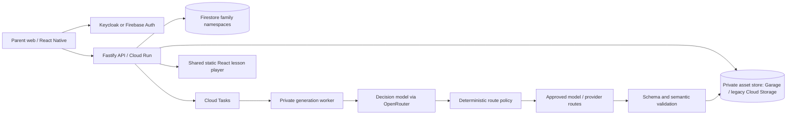

# Architecture

Status: approved design; implementation evidence is tracked in milestones.md.

Public Hosting contains code only. Family JSON/assets require authenticated API access; signed asset URLs, if introduced, are short-lived bearer credentials. ID randomness is not authorization. The API verifies the provider's access token (Keycloak JWKS or Firebase Admin SDK) and derives parent identity from its subject, never a request parent_id. All direct client Firestore/Storage access is denied.

Node/TypeScript + Fastify, npm workspaces, Firestore, Storage and Cloud Tasks. A
no-Google VPS migration to PostgreSQL, Garage, Keycloak and polling dispatch is in
progress (ADR 0013, ADR 0014); Firestore, Firebase Auth, Cloud Storage and Cloud
Tasks remain the active runtime until the later phases land. React/Vite player;
React Native with Expo as local native-build tooling, without EAS or OTA services.
Static player artifact is bundled into mobile. Only structured lesson data crosses
its bridge. No parent token enters lesson JSON.

Each stage persists input/output references and versioned state. Transactional claims, lease fencing, idempotency keys and an outbox prevent duplicate publication and lost dispatch. Cancellation/deletion tombstones win over stale workers. Cloud workers verify service identity; emulator dispatch is local and must never authenticate production requests.

OpenRouter and its downstream providers are separate processors requiring review. Route policy limits models, providers, capabilities, cost and retries. Live AI is disabled by default. Mocked development is not a production moderation or learning-quality assessment.

The player renders without network access when supplied its bundle, JSON and assets. Phase 1 does not expose an ungated kid mode. Implemented Phase 2: a scrypt-hashed family PIN gates the parent tools while child play stays open, assignments pin approved revisions per child, profiles are bounded at four per family, approved lesson JSON and per-kid summaries are cached locally, and player events queue durably in localStorage until batched delivery succeeds. The queue is client mutation risk, not an authorization boundary: the API revalidates ownership, revision and idempotency for every batch.

Implemented local transport uses a polling worker against the Firebase emulators, with
private assets in Garage. `ASSET_STORE=s3` selects the S3 adapter; the default remains
Firebase Storage for rollback. Cloud-mode dispatch through Cloud Tasks, the outbox
sweeper and the OIDC-verified private worker endpoint are implemented behind injected
publishers/verifiers and tested against fakes; real Cloud Tasks delivery, Google-signed
OIDC verification and a Cloud Run deployment remain externally unverified and the
deploy gate still fails by design. The OpenRouter adapter and routing policy are tested through injected HTTP/model mocks; the local entrypoint refuses live mode. The shared player source is used by the website and its compiled static artifact by mobile. PDF text parsing is isolated in a worker thread with a timeout and heap limit; threads do not replace a production container sandbox.
