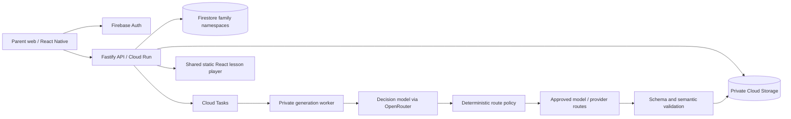

# Architecture

Status: approved design; implementation evidence is tracked in milestones.md.

Public Hosting contains code only. Family JSON/assets require authenticated API access; signed asset URLs, if introduced, are short-lived bearer credentials. ID randomness is not authorization. The API verifies Firebase tokens and derives parent identity from the token, never a request parent_id. All direct client Firestore/Storage access is denied.

Node/TypeScript + Fastify, npm workspaces, Firestore, Storage and Cloud Tasks. React/Vite player; React Native with Expo as local native-build tooling, without EAS or OTA services. Static player artifact is bundled into mobile. Only structured lesson data crosses its bridge. No parent token enters lesson JSON.

Each stage persists input/output references and versioned state. Transactional claims, lease fencing, idempotency keys and an outbox prevent duplicate publication and lost dispatch. Cancellation/deletion tombstones win over stale workers. Cloud workers verify service identity; emulator dispatch is local and must never authenticate production requests.

OpenRouter and its downstream providers are separate processors requiring review. Route policy limits models, providers, capabilities, cost and retries. Live AI is disabled by default. Mocked development is not a production moderation or learning-quality assessment.

The player renders without network access when supplied its bundle, JSON and assets. Phase 2 adds assigned-lesson caching, profile locks and offline event delivery; Phase 1 does not expose an ungated kid mode.

Implemented local transport uses a polling worker against the Firebase emulators. Cloud Tasks/outbox dispatch and IAM/OIDC delivery remain planned. The OpenRouter adapter and routing policy are tested through injected HTTP/model mocks; the local entrypoint refuses live mode. The shared player source is used by the website and its compiled static artifact by mobile. PDF text parsing is isolated in a worker thread with a timeout and heap limit; threads do not replace a production container sandbox.
