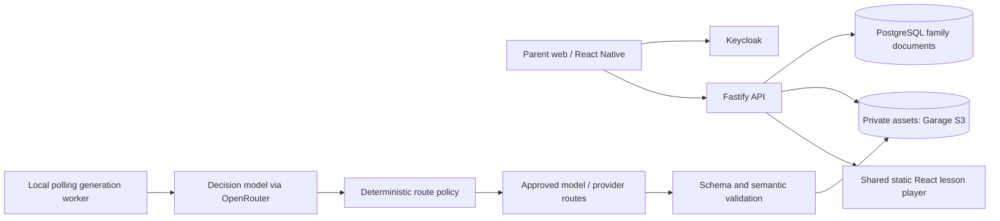

# Architecture

Status: approved design; implementation evidence is tracked in milestones.md.

Public hosting contains code only. Family JSON/assets require authenticated API access; signed asset URLs, if introduced, are short-lived bearer credentials. ID randomness is not authorization. The API verifies the Keycloak access token against the realm JWKS and derives parent identity from its subject, never a request parent_id. No client has direct database or object-store access.

Node/TypeScript + Fastify, npm workspaces, PostgreSQL, Garage (S3-compatible) and
Keycloak on a self-hosted VPS (ADR 0013–0015). React/Vite player; React Native with
Expo as local native-build tooling, without EAS or OTA services. Static player
artifact is bundled into mobile. Only structured lesson data crosses its bridge.
No parent token enters lesson JSON.

Each stage persists input/output references and versioned state. Transactional claims, lease fencing and idempotency keys prevent duplicate publication; the local polling worker recovers stalled leases and due retries. Cancellation/deletion tombstones win over stale workers. The identity provider is the only token authority; the local entrypoint must never authenticate production requests.

OpenRouter and its downstream providers are separate processors requiring review. Route policy limits models, providers, capabilities, cost and retries. Live AI is disabled by default. Mocked development is not a production moderation or learning-quality assessment.

The player renders without network access when supplied its bundle, JSON and assets. Phase 1 does not expose an ungated kid mode. Implemented Phase 2: a scrypt-hashed family PIN gates the parent tools while child play stays open, assignments pin approved revisions per child, profiles are bounded at four per family, approved lesson JSON and per-kid summaries are cached locally, and player events queue durably in localStorage until batched delivery succeeds. The queue is client mutation risk, not an authorization boundary: the API revalidates ownership, revision and idempotency for every batch.

The local transport is a polling worker over Postgres-backed jobs, with private
assets in Garage and identity in Keycloak. Generation dispatch is asynchronous,
persisted and idempotent; the deploy gate still fails by design until the VPS
deployment path is built. The OpenRouter adapter and routing policy are tested
through injected HTTP/model mocks; the local entrypoint refuses live mode. The
shared player source is used by the website and its compiled static artifact by
mobile. PDF text parsing is isolated in a worker thread with a timeout and heap
limit; threads do not replace a production container sandbox.
